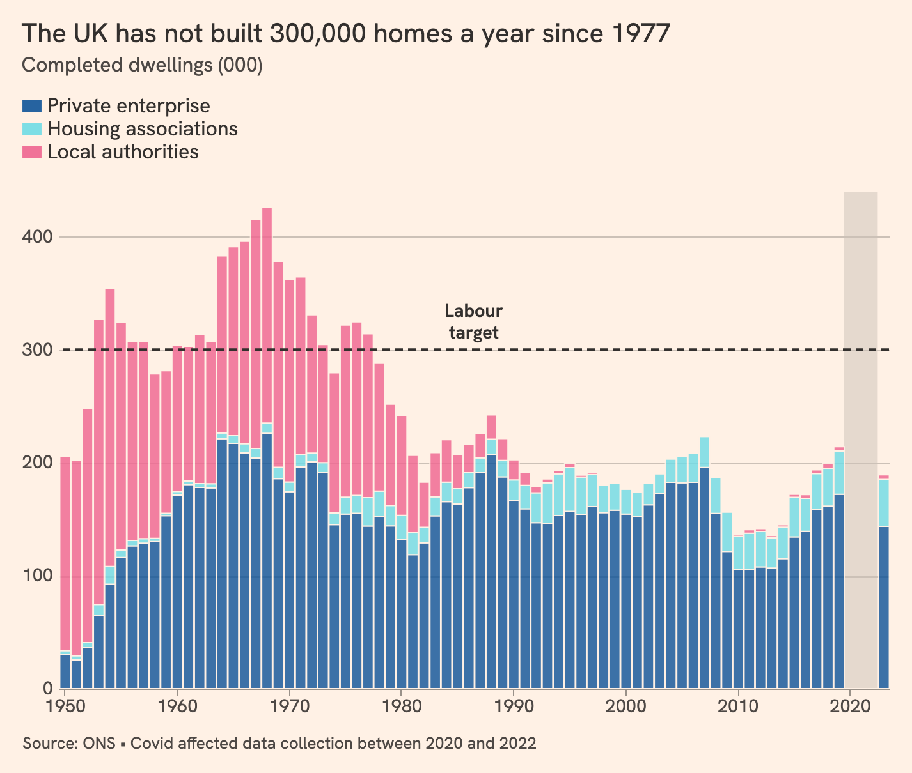

# FT housebuilding chart

A recreation of the Financial Times chart [The UK has not built 300,000 homes a year since 1977](https://www.ft.com/content/40ecd316-7f15-43a9-afe3-6095c6081e00) (July 2024).

Walkthrough: [tutorials/ft-housebuilding.html](../../../../tutorials/ft-housebuilding.html)

| Target (FT) | Recreation |
|---|---|
|  |  |

## Steps

| Step | Spec | Altair | What changes |
|---|---|---|---|
| 1 | [`01_simple_bar.json`](specs/01_simple_bar.json) | [`01_simple_bar.py`](altair/01_simple_bar.py) | Vega-Lite's simple bar chart example, pointed at our CSV |
| 2 | [`02_temporal_stacked.json`](specs/02_temporal_stacked.json) | [`02_temporal_stacked.py`](altair/02_temporal_stacked.py) | `Period` as a date; `color` by sector |
| 3 | [`03_size_axes.json`](specs/03_size_axes.json) | [`03_size_axes.py`](altair/03_size_axes.py) | FT plot size, filter to 1950 on, one centred bar per year, stripped-back axes |
| 4 | [`04_colours.json`](specs/04_colours.json) | [`04_colours.py`](altair/04_colours.py) | FT background, bar colours and opacity |
| 5 | [`05_legend_order.json`](specs/05_legend_order.json) | [`05_legend_order.py`](altair/05_legend_order.py) | Legend above the chart; custom stack order |
| 6 | [`06_layers_target.json`](specs/06_layers_target.json) | [`06_layers_target.py`](altair/06_layers_target.py) | Layered spec; dashed target line and label |
| 7 | [`07_missing_data.json`](specs/07_missing_data.json) | [`07_missing_data.py`](altair/07_missing_data.py) | Shaded area over 2020 to 2022 |
| 8 | [`08_titles_font.json`](specs/08_titles_font.json) | [`08_titles_font.py`](altair/08_titles_font.py) | Title, subtitle, source note, font, legend placement |
| 9 | [`09_finishing.json`](specs/09_finishing.json) | [`09_finishing.py`](altair/09_finishing.py) | Gaps between stacked segments; tooltip |

Each Altair script renders the same chart as its spec, pixel for pixel (checked with Vega-Lite 6.4.3 and Altair 6.3).

## Data

- The specs load [`Data/ONS_UK_housebuilding_long.csv`](../../../../Data/ONS_UK_housebuilding_long.csv), downloaded from the ONS in 2024. It runs to 2023, like the FT chart.
- [`data/prepare_data.py`](data/prepare_data.py) downloads the current ONS workbook and reshapes table 3a into the same long format. Its output, [`data/ons_housebuilding_uk_long.csv`](data/ons_housebuilding_uk_long.csv), runs to 2025 (provisional) and includes ONS revisions to earlier years (2023 private completions rose by about 5,000).

## Notes

- The FT built the original in Flourish (the SVG uses `fl-` class names).
- The FT uses Metric, a licensed typeface. The recreation uses [Hanken Grotesk](https://fonts.google.com/specimen/Hanken+Grotesk) from Google Fonts, which needs loading on the page before the chart draws. In Colab and the Vega Editor the chart falls back to Arial.
- Vega-Lite has no pattern fills. The walkthrough's "Going further" section shows the FT's hatching with an SVG `<pattern>`, which only works with the SVG renderer on a page that defines the pattern.
