# Vega-Lite Templates

<aside>
🌐 Create chart templates for different organisations

</aside>

[CSS extraction](https://app.notion.com/p/CSS-extraction-119ee036625080a6ab43fa2b4279fbce?pvs=21)

<u>Tools</u>

For HTML code highlighting: [Prism CDNs](https://cdnjs.com/libraries/prism/1.29.0), [info](https://prismjs.com/download.html#themes=prism&languages=markup+css+clike+javascript)

### Ideas

The Economist. Indexed line chart, e.g.

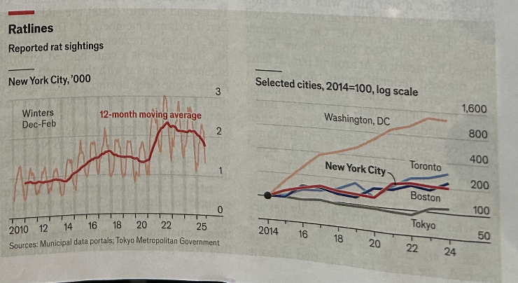

## The Economist

Ideas: [https://www.economist.com/topics/graphic-detail](https://www.economist.com/topics/graphic-detail)

Stock markets multi-line chart. [here](https://www.economist.com/graphic-detail/2025/01/03/the-secret-to-one-of-europes-best-performing-stockmarkets)

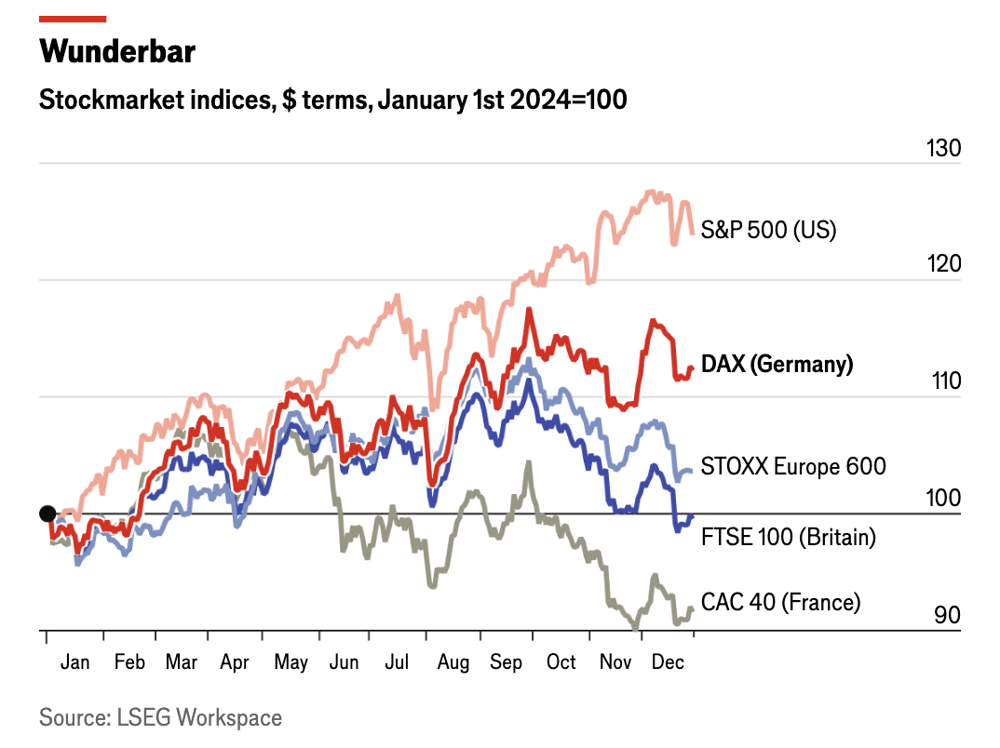

Where can we get the data? Maybe FRED: [https://fred.stlouisfed.org/categories/32255](https://fred.stlouisfed.org/categories/32255)

---

### FT

- <u>Example: simple</u>
- <u>Example: advanced</u>
    
    **Housebuilding**: [link](https://www.ft.com/content/40ecd316-7f15-43a9-afe3-6095c6081e00)
    
    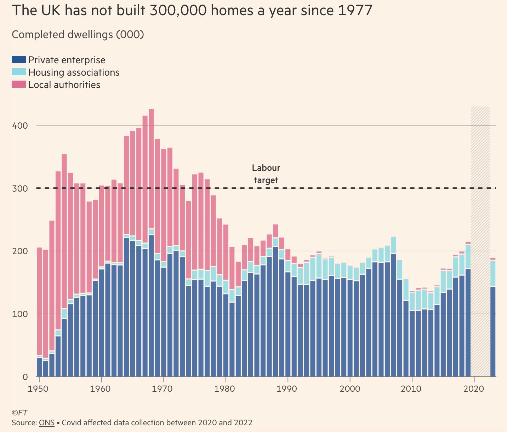
    
    **Schools**: [link](https://www.ft.com/content/40ecd316-7f15-43a9-afe3-6095c6081e00)
    
    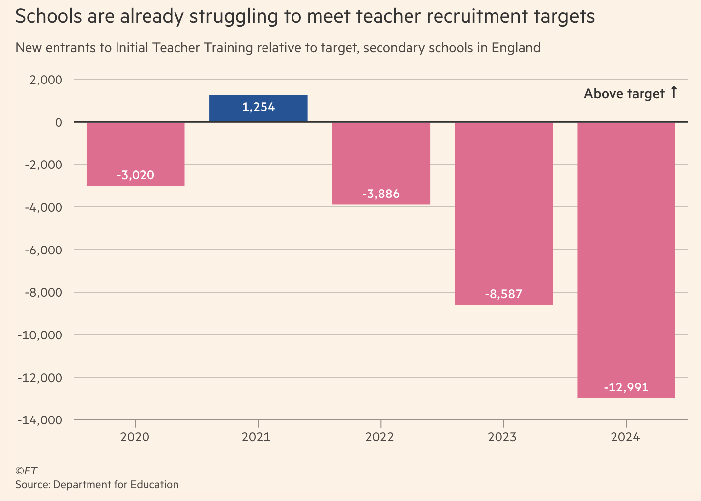
    

Ex. Adv. **Housebuilding** 

Skip to section 2 if you’re just interested in the styling.

1. Getting the data
    1. The FT chart links to the [ONS dataset](https://www.ons.gov.uk/peoplepopulationandcommunity/housing/datasets/ukhousebuildingpermanentdwellingsstartedandcompleted) in its source, so let’s follow this and download the Excel file.
    2. Looking at the `Contents`, the sheet we want is 3A (Table 3a - House building: permanent dwellings completed, by sector, United Kingdom, historical calendar year series)
    3. The FT chart contains data for ‘Completed’ dwellings, so we can discard the data on ‘housing starts’.
    4. Create a new sheet that we can copy the data to - this will allow us to save it in a CSV format. 
    5. Copy across just the headings and the data for `Period`, and the `Completed` columns. Since we are building a stacked bar chart, we don’t need the values for the total completed (the combined values will sum to the total, so we can always access it through this later).
        
        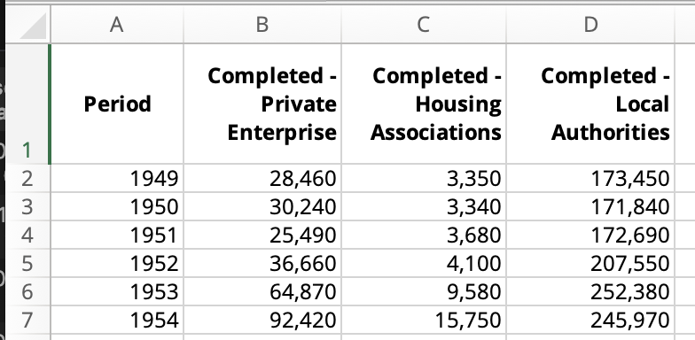
        
    6. We can clean up the column names.
    7. Building charts in Vega-Lite is easiest when the data is in long (tabular) format. So, we can create a new sheet where we stack the data vertically. To make this work, we’ll add a column for `Sector`, which will either be `Private enterprise`, `Housing associations`, or `Local Authorities`. Then, we’ll add a column to contain the values, which we can call `Completed`.
    8. I’ll also change the format of the `Completed` column from `number` to `general`, this will ensure we export the CSV with no commas in the values.
        
        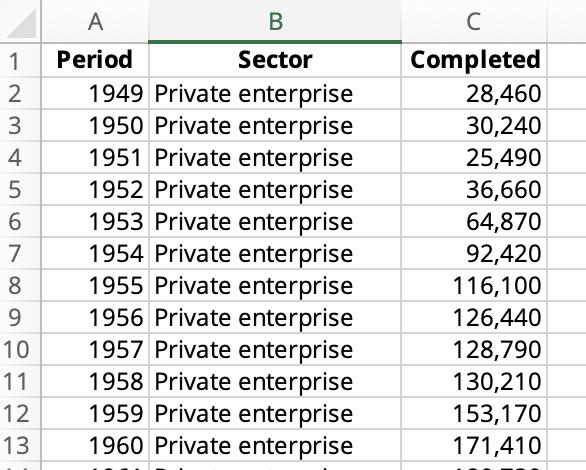
        

1. Building the chart
    
    For this, I’ve saved the data to a public GitHub repository. This way, we can use the *raw* GitHub file link
    
    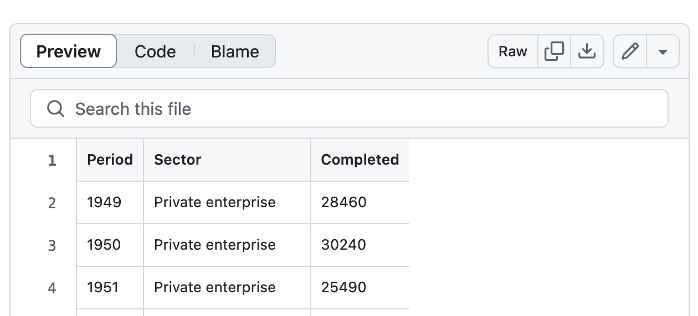
    
    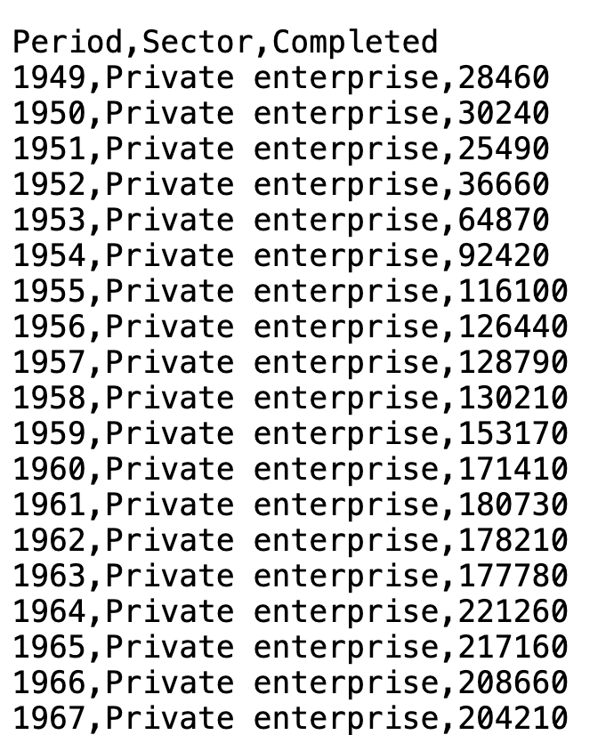
    
    - We’ll start with Vega-Lite’s ‘simple bar chart’ example.
    - Replace values in `data` with `url`
        
        ```tsx
          "data": {
            "url": "https://raw.githubusercontent.com/jhellingsdata/jhellingsdata.github.io/refs/heads/main/Data/ONS_UK_housebuilding_long.csv"
          },
        ```
        
    - We don’t yet see any data. This is because the fields specified in the axis encodings still relate to the example data. Update the `x` field name to "Period” and the `y` field name to “Completed".
        
        ```tsx
          "encoding": {
            "x": {"field": "Period", "type": "nominal"},
            "y": {"field": "Completed", "type": "quantitative"}
          }
        ```
        
    - Currently, our x-axis data type is set as “nominal”. We’ll update this to temporal.
    - Our chart is nearly correct, but currently the data is being aggregated together, since we have only defined the time period and number of completions. To fix this, we’ll need to separate by `Sector`, by adding a `color` property to our encodings.
        
        ```tsx
          "encoding": {
            "x": {
              "field": "Period",
              "type": "temporal"
            },
            "y": {"field": "Completed", "type": "quantitative"},
            "color": {
              "field": "Sector",
              "type": "nominal"
            }
          }
        ```
        
    
    **Layering**
    
    - Lastly, we can take a step to make some later steps easier. The target chart contains a few data elements in addition to the main stacked bars:
        - Stacked bars showing house build completions (mark bar)
        - Dashed horizontal line calling out a value (mark line)
        - Text label for the dashed horizontal line (mark text)
        - Shaded grey area across period of missing data (mark rect)
    - To achieve the same, we’ll need to *layer* each of these chart elements into a single chart specification. So, we’ll set up the basic frame for this which we’ll add to in turn.
        
        ```json
          "layer": [
            {
              "mark": "bar",
              "encoding": {
                "x": {
                  "field": "Period",
                  "type": "temporal",
                  "axis": {
                    "title": "",
                    "grid": false,
                    "domainColor": "rgb(153, 145, 137)"
                  }
                },
                "y": {
                  "field": "Completed",
                  "type": "quantitative",
                  "axis": {
                    "title": "",
                    "gridColor": "rgb(204,193,183",
                    "domain": false,
                    "ticks": false,
                    "labelPadding": 5
                  }
                },
                "color": {
                  "field": "Sector",
                  "type": "nominal"
                }
              }
            }
          ]
        ```
        
        We can then add layers to the chart by adding {} objects to the layer array.
        
        ```json
        "layer": [
        	{
        		...
        	},
        	{
        	...
        	},
        	{
        	...
        	}
        ]
        ```
        
2. <u>**Personalising the chart**</u>
    
    **Sizing**
    
    - Using the browser inspect tool, we can check the dimensions of the FT chart.
        
        The graphic size is 700x417 - in between a 16:9 and 16:10 aspect ratio.
        
        The data area is about 649x382.
        
    
    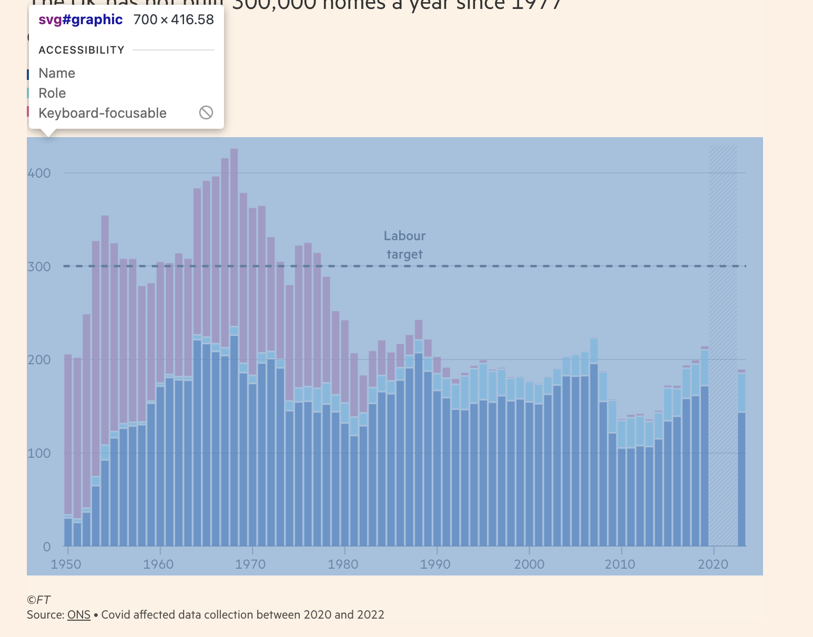
    
    - If we set the `height` and `width` properties to these values, our chart area would be much bigger.
    - Notice how the FT have maximised the amount of space showing the data relative to the whole chart area.
        
        <aside>
        🌐
        
        This follows Edward Tufte’s concept of the *data-ink ratio*. That is, to communicate data as efficiently as possible, elements that are unnecessary and distract from the visualisation's message should be minimised.
        
        </aside>
        
    - We go with smaller sizing for now, but with a similar aspect ratio.
        
        ```json
          "width": 480,
          "height": 300,
        ```
        

**Axis**

- The FT doesn’t tend to use x-axis grid lines. They also clean up the spec by removing the y-axis domain line and lightening the y-axis grid lines. To find the exact colour used for the grid lines, I’ve looked through the chart code through the inspect browser tool. This shows the `stroke` colour to be “rgb(204,193,183)”, with a stroke-width of 1px. The default vega-lite grid width is 1px, so we don’t need to specify this. To adjust the grid colour, we use the `gridColor` property in the y axis property.
    
    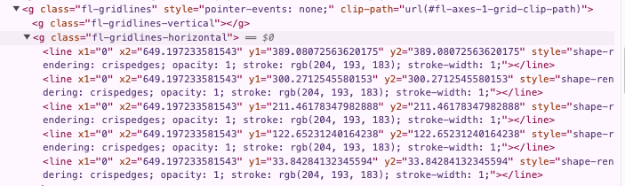
    
    ```json
        "y": {
          "field": "Completed",
          "type": "quantitative",
          "axis": {
            "gridColor": "rgb(204,193,183)",
          }
        },
    ```
    
- After removing the y-axis domain, you’ll see we still have a lighter line in its place. If we remove the grid and domain of both axes, then we can see that a line stroke surrounds the entire data area.
    
    <aside>
    🌐
    
    To remove the chart line stroke, we’ll need to specify a config option for the view property. 
    
    ```json
      "config": {
        "view": {
          "stroke": "transparent"
        }
      },
    ```
    
    </aside>
    
- Axis titles are also removed. This is generally a good principle, particularly when showing time-series data (you don’t need to be told you’re reading a date). By stating the data series on display in the subtitle, we can also remove the y-axis title.
- Tick labels: to control the number of labels, we can specify the `tickCount` property.
    
    ```json
        "y": {
          "field": "Completed",
          "type": "quantitative",
          "axis": {
            "tickCount": 4
          }
        },
    ```
    
- y-axis labels: shorten to 000’s
    - Our data scale is in hundreds of thousands, but these large labels take up a lot of chart space. To make this cleaner, we can divide the displayed label values by 1000 through a label expression.
        
        ```json
        "axis": {
        	 "labelExpr": "datum.value / 1000"
        }
        ```
        

**Legend**

<u>Position</u>

To customise the `legend`, we’ll need to add a legend property to our colour encoding. For quick position changes, we can set the `orient` to “top”, then the legend direction to “vertical”. 

```json
  "color": {
    "field": "Sector",
		...
    "legend": {
      "orient": "top",
      "direction": "vertical",
      "title": null
    }
  }
```

**Font**

- [https://stackoverflow.com/questions/59122012/vega-lite-font-availability](https://stackoverflow.com/questions/59122012/vega-lite-font-availability)
- Inspect the browser, find chart elements to see CSS font.
- <link rel="preload" as="font" href="[https://www.ft.com/__origami/service/build/v3/font?font_format=woff2&amp;font_name=MetricWeb-Semibold&amp;system_code=origami&amp;version=1.12](https://www.ft.com/__origami/service/build/v3/font?font_format=woff2&amp;font_name=MetricWeb-Semibold&amp;system_code=origami&amp;version=1.12)" type="font/woff2" crossorigin="anonymous">
- [https://www.ft.com/__origami/service/build/v2/demos/o-fonts@2.1.4/metricweb](https://www.ft.com/__origami/service/build/v2/demos/o-fonts@2.1.4/metricweb)
    
    CSS: [https://public.flourish.studio/fonts/d64d08a8-9f67-426c-bc9f-fdb97e7e24cc/stylesheet.css](https://public.flourish.studio/fonts/d64d08a8-9f67-426c-bc9f-fdb97e7e24cc/stylesheet.css)
    
- Similar free fonts?
    - Avenir, Futura
    - 

To find colours & styles:

- Use inspect browser tab.
- Select this tool. This will automatically find the HTML element for wherever we hover our mouse.
    
    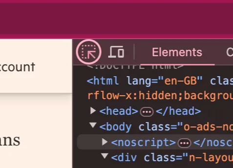
    
- Hover over a single bar for ‘local authorities’, which should then pinpoint that element in the HTML code. Below the code, we should be able to see a styles tab, which contains all the styles that are being applied to that element.
    
    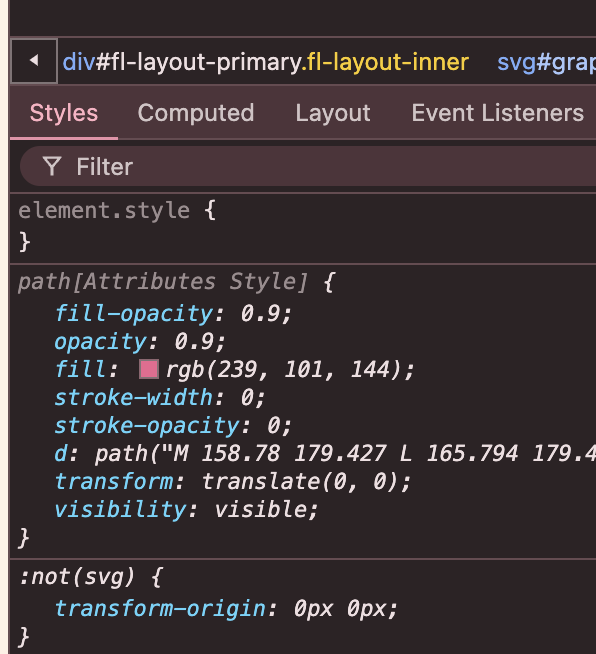
    
    - Through this, we can see the exact colour for these each bar!

<u>Bar Colours</u>

- **Local authorities** - “rgb(239,101,144,0.9)” (Note, I’ve added 0.9 here as a quick way to apply opacity to our rgb colour.
- **Housing associations - “r**gb(112, 220, 230, 0.9)”
- **Private enterprise** - “rgb(15, 84, 153, 0.9)”

To apply each colour to a respective bar, we’ll use the `range` property in the `scale` options of the colour encoding.

```json
"color": {
  "field": "Sector",
  "type": "nominal",
  "scale": {
    "range": ["rgb(15,84,153,0.9)", "rgb(112,220,230,0.9)", "rgb(239,101,144,0.9)"],
    "domain": ["Private enterprise", "Housing associations", "Local authorities"]
  }
}
```

Note: By default, the values in “Sector” are sorted alphabetically, so the rgb values in the `range` array will apply to each Sector value in its alphabetical order (i.e. “Housing associations” would come first, so we should set its colour as the first value in the range array). If we want to change this order, we can specify the `domain` (i.e. the possible values in Sector), and match the order of the labels in the original chart legend.

- <u>Chart spec so far</u>
    
    ```json
    {
      "$schema": "https://vega.github.io/schema/vega-lite/v5.json",
      "data": {
        "url": "https://raw.githubusercontent.com/jhellingsdata/jhellingsdata.github.io/refs/heads/main/Data/ONS_UK_housebuilding_long.csv"
      },
      "config": {
        "view": {
          "stroke": "transparent"
        },
        "axis": {
          "labelColor": "#33302e"
        }
      },
      "background": "#fff1e5",
      "width": 480,
      "height": 300,
      "layer": [
        {
          "mark": "bar",
          "encoding": {
            "x": {
              "field": "Period",
              "type": "temporal",
              "axis": {
                "title": "",
                "grid": false,
                "domainColor": "rgb(153, 145, 137)"
              }
            },
            "y": {
              "field": "Completed",
              "type": "quantitative",
              "axis": {
                "title": "",
                "gridColor": "rgb(204,193,183)",
                "domain": false,
                "ticks": false,
                "labelPadding": 5,
                "tickCount": 4,
                "labelExpr": "datum.value / 1000"
              }
            },
            "color": {
              "field": "Sector",
              "type": "nominal",
              "scale": {
                "range": ["rgb(112,220,230,0.9)", "rgb(239,101,144,0.9)", "rgb(15,84,153,0.9)"]
              },
              "legend": {
                "orient": "top",
                "direction": "vertical",
                "title": null
              }
            }
          }
        }
      ]
    }
    
    ```
    

### Layer: rule with target y=300

<u>New layer: line/rule with target value of y=300,000</u>

```json
"layer": [
	{
		<- existing bar layer->
	},
  { 
    "data": {"values": [{"target": 300000}]},  // Define a custom value for our line
    "mark": {"type": "rule"}, // Use a 'rule' type, so just a line either horizontal or vertical
    "encoding": {
      "y": {"field": "target", "type": "quantitative"} // Set our y field to the data variable we defined
    }
  }
]
```

### Layer: text

Add text annotation to our rule.

Since we want our text to be around the ‘300’ mark of our rule, we can save some code by adding a nested layer. 

1. Add a new data point to our inline data with the label text. Setting the value as a list allows us to easily create line-wrapping. 
2. Add a layer property to our new rule, then move just the `mark` object into the first layer (properties we want shared are kept outside the layer, so the `data`  and y-axis encoding can remain above).

 

```json
{ 
    "data": {"values": [{"target": 300000, "label": ["Labour", "target"]}]},
    "encoding": {
      "y": {"field": "target", "type": "quantitative"}
    },
    "layer": [
      {
        "mark": {"type": "rule", "strokeDash": [6, 6], "strokeWidth": 2.2, "color": "rgb(51,51,51)"}
      },
      {
        "mark": {
          "type": "text", "align": "center", "dy": -22, "x": {"expr": "width /2"}, "color": "rgb(51,51,51)"
        },
        "encoding": {
          "text": {"field": "label", "type": "nominal"}
        }
      }
    ]
}
```

- Alternative (two separate layers)
    
    ```json
    
    ```
    

### Layer: shaded area

In the HTML:

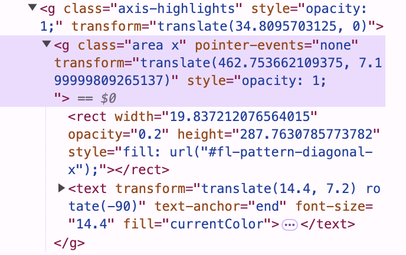

### Titles

**Main chart title**

**Footer**

Options:

- Move the title to the bottom (doesn’t work if we also want a title at the top)
- Move the x or y axis title to this position
- Manually add a text layer and move it here.

```json

```

### Custom order

To fully match the original chart, we need to adjust the order of the labels in the legend, as well as the order in which the bars are stacked. Sometimes fine-tuning the sorting behaviour can be a little tricky. 

What’s the default behaviour?

- By default, when sorting on categorical (i.e. nominal) data, like our ‘Sector’ values, the sort will be performed alphabetically. So, Housing, Local, Private is our order in the legend, and the order the bars are stacked top to bottom.

To control the order in which the bars are stacked, we can add an ‘order’ encoding channel:

```json
"encoding": {
	...
	"color": {...},
	"order": {"field": "Sector", "sort": "ascending"}
}
```

However, this will just only allow our original alphabetical sort or a reverse alphabetical. We want the bars in the order “Local authorities”, “Housing associations”, “Private enterprise”, which isn’t alphabetical in either direction. One approach could be to create a custom field, either in our data cleaning phase or in the chart with a transform calculate to conditionally create an order of say 1,2,3 for the order we want — then set our order field as this new variable.

Instead, we might notice that at our most recent value, the bars are stacked from high to low (i.e. the smallest value, Local authorities, is stacked on top). This order is maintained throughout, so we could try to sort the bars just on the last `Completed` value for each sector.

```json
"order": {"field": "max(Completed)"}
```

This does the trick.

- **Spec**
    
    ```json
    {
      "$schema": "https://vega.github.io/schema/vega-lite/v5.json",
      "data": {
        "url": "https://raw.githubusercontent.com/jhellingsdata/jhellingsdata.github.io/refs/heads/main/Data/ONS_UK_housebuilding_long.csv"
      },
      "config": {
        "view": {
          "stroke": "transparent"
        },
        "axis": {
          "labelColor": "#33302e"
        }
      },
      "background": "#fff1e5",
      "width": 480,
      "height": 300,
      "layer": [
        {
          "mark": "bar",
          "encoding": {
            "x": {
              "field": "Period",
              "type": "temporal",
              "axis": {
                "title": "",
                "grid": false,
                "domainColor": "rgb(153, 145, 137)"
              }
            },
            "y": {
              "field": "Completed",
              "type": "quantitative",
              "axis": {
                "title": "",
                "gridColor": "rgb(204,193,183)",
                "domain": false,
                "ticks": false,
                "labelPadding": 5,
                "tickCount": 4,
                "labelExpr": "datum.value / 1000"
              }
            },
            "color": {
              "field": "Sector",
              "type": "nominal",
              "scale": {
                "range": ["rgb(112,220,230,0.9)", "rgb(239,101,144,0.9)", "rgb(15,84,153,0.9)"]
              },
              "legend": {
                "orient": "top",
                "direction": "vertical",
                "title": null
              }
            }
          }
        },
        { 
          "data": {"values": [{"y": 300000}]},
          "mark": {"type": "rule"},
          "encoding": {
            "y": {"field": "y", "type": "quantitative"}
          }
        }
      ]
    }
    ```
    

**Left to do**

- [x]  Add shaded area for missing data
- [x]  Add y-rule for Labour target
- [x]  Add y-rule label for target
- [x]  Add custom sort ordering.
- [x]  Add custom font

- [ ]  Tidy up webpage
- [ ]  Send key charts to RD

### Key steps

c2 - Adapted simple bar chart.

I am writing a blog series that will serve as a learning tool for the Vega-Lite visualisation language. As part of this series, I will demonstrate how to recreate charts from a selection of large new organisations, as a means of teaching the available styling options in Vega-Lite. To start, we are recreating a stacked bar chart from the Financial Times, showing historical housebuilding in the UK by sector.

I think the FT uses D3 for its visualisations. I'd like to find out how we can extract all the exact colours and formatting being applied to each chart element. I have found the entire HTML element for the chart and uploaded it to you. Please determine whether we can extract these styling details from this or whether we'll need to find another source, perhaps their source CSS file.